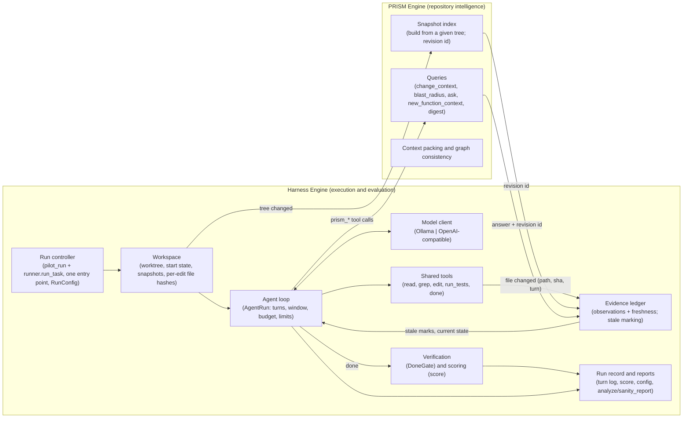

# Architectural review: a unified Harness Engine for PRISM (2026-11-12)

**Status:** an architecture assessment only. No code was changed for this review.

**Evidence base:**
- the repository at `13029511` and later;
- the logs of sanity runs 1–4 (`reports/r4/sanity*/`) and of the planning investigation (`reports/r4/planning/`);
- the analyses `SANITY_ROOT_CAUSES.md`, `SANITY2_RESULTS.md`, `SANITY3_RESULTS.md`, `PLANNING_INVESTIGATION.md` and
  `THINKING_R4_ANALYSIS.md`.

**Labels:** **Fact** (verified in code or logs), **Interpretation** (my reading), **Assumption / unknown** (needs
evidence).

**Verdict: recommended with modifications.** An implicit Harness Engine already exists. Make it explicit, give it one
entry point and one supported contract with PRISM, and build only the parts the evidence supports. Most of the nine
layers either already exist or are not justified yet.

---

## A. The current architecture

### A.1 The execution path R4 uses (Fact)

```
kaggle/r4_sanity*_cell.py                 # session: clones, Ollama, disk guards, resume, push
  -> harness/experiments/r3/pilot_run.py  main(): task x seed x version, one process per run, resumable
     -> r3/runner.py  run_task()          # worktree, start patch, env setup, index, tools, loop, scoring
        -> r3/shared_tools.make_env       # r3/pybuild.PyEnv | r3/jsbuild.JsEnv  (install, run_test)
        -> r3/working_index.WorkingIndex  # shadow worktree, drift probe, gate on parse errors, full rebuild
        -> r3/tools.ToolLayer             # PRISM's 5 tools (or the baseline's related_code), 4k-token cap
        -> r3/shared_tools.SharedTools    # read_file, list_dir, grep, edit_file, run_tests, done
        -> r4/done_gate.DoneGate          # verification at done (R4-SANITY-2..4)
        -> r4/progress_ledger.ProgressLedger  # the per-turn summary (R4-SANITY-4)
        -> r3/loop.AgentRun.run()         # turns, window rule, budget, turn cap, stuck_done, turn log
        -> r3/runner.score()              # hidden patch, fail-to-pass/pass-to-pass, must_be_absent
  -> r3/analyze.py, r4/sanity_report.py   # outcomes, diagnostics, layers 1-3, gate counters
```

**Tasks** are built offline by:
- `r3/gate.py` (R3's gate: `run_states`, `classify`);
- `r4/gate_families.py`;
- `r4/sanity_tasks.py`, `r4/sanity_gate_tasks.py` and `r4/sanity3_tasks.py` (prompts, start-state test lists, gate
  checks).

**Model access:** `r3/loop.OllamaChat`, Ollama's `/api/chat` only. There is no OpenAI-compatible client (Fact). The
older runners use `harness/llm.py` separately.

### A.2 Other runners (Fact)

About a dozen experiment-specific runners exist besides R3/R4's: `harness/experiments/{r1,r2,layer4,change_history,
retrieval_pivot,final_validation,...}/run*.py`, `harness/arms/arm4_agent.py`, and `benchmarks/final_sweep/runner.py`.
They predate the R3 loop and are not used by R4.

### A.3 PRISM's surface (Fact)

- **Tool functions:** `src/prism/mcp/server.py` exposes `prism_slice`, `prism_explain`, `prism_blast_radius`,
  `prism_change_context`, `prism_ask`, `get_graph_status`, `reindex_repo`, and others. Each takes a `repo_path` and
  resolves it through a module-level `GraphCache`.
- **A graph revision ID:** `RepoContext.snapshot_signature` (`prism/traversal/_cache_keys.snapshot_signature`) is
  reported by `get_graph_status` and `reindex_repo`. **The answers do not carry it:** neither `_build_envelope_response`
  nor `prism_change_context` returns a revision.

### A.4 Ownership problems the code shows (Fact)

1. **The harness reaches into PRISM's private state.** `r3/tools.ToolLayer._install()` builds a `RepoContext` from the
   `WorkingIndex`'s builder and writes it into `server._cache._entries`, clears `server._nlq_indexes`, calls
   `evict_derived_caches()`, and in `close()` deletes from `prism.parser.cache._cache` under `_lock`.
   - **Why it does this:** PRISM has no supported way to say "answer from this snapshot I built".
   - **The consequence:** this is the tightest coupling in the system, and it breaks silently if PRISM's cache
     internals change.
2. **Index freshness has one owner; answer freshness has none.**
   - **Fresh:** `ToolLayer._sync()` calls `WorkingIndex.refresh()` before every index-backed call, so PRISM always
     answers from the current tree. Gated files keep their last parsable bytes.
   - **Not tracked:** nothing records which earlier answers in the agent's history were produced from an older
     graph.
3. **The agent's history has no notion of staleness.** `AgentRun.window()` stubs the oldest tool outputs to fit the
   context, but never marks an output as out of date. Earlier `read_file` and `run_tests` outputs stay in the history
   looking current.
4. **Policy is spread across modules through task flags.**
   - **Each flag switches on code elsewhere:** `done_gate` switches on the gate (`runner._gate`); `explicit_tools`
     on the explicit messages (`SharedTools(explicit=...)`); `restore_scored_tests` on the scored-test restore
     (`runner.score`).
   - **Others arrive as command-line flags** through `pilot_run` → `runner`: `--plan`, `--think`, `--ledger`,
     `--model`.
   - **The result:** this works and is tested, but a run's configuration is recorded in two places (the task file and
     the command line). Nothing yet writes one record of "the configuration this run ran under".
5. **Only one model provider:** `OllamaChat` is the only client the R3 loop knows.

### A.5 Problems the logs show (Fact; causation stated where established)

| Problem | Evidence | Causation |
|---|---|---|
| The model reuses text from before its own edit | sanity 3/4 zod: `old` is the original getter; the error's closest lines show the edited text (`reports/r4/sanity4/r4s-delete-01__BASELINE__42.jsonl`) | established for the instances shown. 74 of the 105 failed S4 edits are exact repeats of an earlier failed edit; how many of those are stale-read caused is **not** established |
| Reasoning from a stale test result | S4 feature-06 PRISM: last `run_tests` at turn 4; the turn-21 thinking reasons from it, while the summary says "last run at turn 4" | established for that run |
| Churn: the same lines edited again and again | S4 feature-06 PRISM: 22 applied edits to line 89, with no test run between them; the loop rule did not flag it (an applied edit resets its counter) | established |
| A stale PRISM answer misleading the model | — | **not observed.** It is a hypothesis by analogy |
| A false done | sanity 1: 25 of 37 failed runs ended on an accepted false done | established. The gate (R4-SANITY-2) addresses it |
| Infrastructure deaths | S4: 3 of 8 runs ended on `model_error: TimeoutError` (900 s client timeout, 12,288-token answer limit, ~14 tok/s) | established |

---

## B. The proposed architecture, as revised



**What changes against today:**
- **A supported "index this snapshot" call** replaces `ToolLayer`'s private-cache injection.
- **Answers carry a revision ID.** It feeds an evidence ledger that marks reads, test results and PRISM answers stale
  when the tree changes.
- **A provider-neutral model client.**
- **One run configuration record.**

The baseline arm uses the same Harness modules, with `related_code` in place of PRISM's queries.

---

## C. The nine layers: responsibility matrix

| Layer | Responsibility | Owner | Existing implementation | Required change | Depends on | Priority |
|---|---|---|---|---|---|---|
| Control / orchestration | run lifecycle, resume, limits, configuration | Harness | `r3/pilot_run.main`, `r3/runner.run_task`, the Kaggle cells | one entry point and one `RunConfig` record (model, flags, task sha, code commit) written per run. Consolidate the flag paths | — | **P1** |
| L1 Task understanding | requirements, acceptance criteria | Harness (offline) | `r4/sanity_tasks.py` prompts, `gate_paragraph`, `sanity3_tasks.describe`; acceptance = `fail_to_pass`/`pass_to_pass`/`must_be_absent`/`visible_start_pass` | none for now. **Not** a model pass at run time: that adds a second model to the loop | task builders | defer |
| L2 Repository / workspace | worktrees, start state, snapshots, edits | Harness | `runner.run_task` (worktree, `apply_patch`, `snapshot_tree`), `runner._restore`, `SharedTools._edit_file` | a per-edit file hash (for churn and freshness). Turn-level checkpoints via `snapshot_tree` | — | **P1** |
| L3 Graph / index lifecycle | build, refresh, gating, revision | **PRISM** (the trigger from the Harness) | `r3/working_index.WorkingIndex` (in the harness tree, but PRISM logic: drift probe, parse-error gate, `build_pipeline`); PRISM's `GraphCache`, `snapshot_signature` | expose "index this tree" and "the current revision" as a supported PRISM API. Move or wrap `WorkingIndex` behind it; retire the private-cache injection | L2 (tree changed) | **P1** |
| L4 Graph intelligence | queries, subgraphs, packing | **PRISM** | `prism/mcp/server.py` tools, `prism/impact/context.py`, `build_context_package` | answers include the revision ID. **No** harness-side subgraph selection | L3 | P1 (the ID only) |
| L5 Execution planning | strategy, tools, next actions | the agent (model); fixed per-task-type rules in the Harness | none (by design; the model chooses tools) | **none dynamic.** If needed, a fixed rule per task type (e.g. a new function → `prism_new_function_context`), part of the experimental design | — | not justified |
| L6 Agent execution | loop, model calls, tools, limits | Harness | `r3/loop.AgentRun`, `OllamaChat`, `parse_call`, `window`, `STUCK_DONE_REJECTIONS` | an OpenAI-compatible client (for gpt-oss-120b on Groq); the window consumes the evidence ledger's stale marks | L7 | **P1** |
| L7 Change / evidence | detect, record, invalidate, present | Harness (record, present), PRISM (the revision) | partial: `ProgressLedger`, `SharedTools._vanished`, `WorkingIndex.refresh().changed`, `ToolLayer.last_refresh` | an evidence ledger (path, sha, turn, revision per observation). Coarse invalidation: an edit to a file makes earlier reads of it, all earlier test results, and PRISM answers from an older revision stale | L2, L3, L6 | **P1** |
| L8 Validation / evaluation | verification, scoring, graph consistency | Harness (gate, scoring, metrics); PRISM (its own index consistency) | `r4/done_gate.DoneGate`, `runner.score`, `r3/analyze`, `r4/sanity_report`; PRISM's golden tests and `WorkingIndex` E1–E3 | a churn-aware edit metric and loop rule. Graph consistency stays a PRISM test concern, not a run-time step | L2, L7 | **P1** (metrics) |
| L9 Results / reporting | history, metrics, reports | Harness | the turn logs (`*.jsonl`), `*.score.json`, `pilot_runs.jsonl`, the reports | add the `RunConfig` and the full prompt hash per turn. **No** cross-run "learning" | all | P2 |

---

## D. The execution lifecycle

The proposed 15 steps, corrected.

**Corrections:**
- **Steps 2 and 4** (the Harness "interprets the task" and "establishes the execution plan") happen offline in the task
  builders, or not at all. At run time they would be a second decision-maker.
- **Step 10's ordering.** PRISM's refresh is already lazy and correct: the refresh runs before each index-backed call,
  not after every edit, which avoids re-indexing on every edit. Keep that.
- **Step 13** (graph consistency) is a PRISM test-suite property, not a per-run step.

**The recommended lifecycle:**

```mermaid
sequenceDiagram
  participant C as Run controller
  participant W as Workspace
  participant L as Agent loop
  participant P as PRISM
  participant E as Evidence ledger
  participant V as Gate/scorer
  C->>W: worktree at parent + start patch; env setup
  C->>P: index snapshot(tree) -> revision r0
  C->>L: task message (prebuilt), RunConfig
  loop each turn (until done accepted, cap, budget, stuck_done)
    L->>L: model call (window = history with stale marks + ledger)
    alt read_file / grep / run_tests
      L->>W: tool
      W-->>E: observation (path, sha, turn) / test result (turn)
    else edit_file
      L->>W: edit
      W-->>E: file changed (path, new sha, turn): mark earlier reads of path and all test results stale
    else prism_* (PRISM arm) / related_code (baseline)
      L->>P: query (refreshes if the tree changed: revision r_n)
      P-->>E: answer + revision: answers from an older revision are marked stale
    else done
      L->>V: gate check (visible tests, target status)
      V-->>L: accepted, or a rejection with what is unmet
    end
  end
  C->>V: score (restore scored tests, hidden patch, sets)
  C->>C: run record (config, turn log, score), push
```

**Failures:**

| Failure | Class | Handling (existing / needed) |
|---|---|---|
| Model or API error, timeout | infrastructure | **existing:** the run ends `model_error`, counted apart. **Needed:** a client timeout that matches the answer limit and speed (S4 lost 3 of 8 runs), and bounded retries with backoff on transient HTTP errors (5xx, 429) for an API provider |
| Tool error (bad arguments, no such file) | recoverable | **existing:** returned to the model as text |
| An edit that does not apply | recoverable | **existing:** explicit errors (closest lines, duplicate lines, whitespace lines) |
| Index refresh fails, or a file does not parse | recoverable | **existing:** the `WorkingIndex` gate keeps the last parsable bytes and adds a notice |
| A stale observation | recoverable | **needed:** evidence-ledger marks (L7) |
| Churn | diagnostic | **needed:** a metric. Report it; do not end runs on it (false positives are cheap that way) |
| A false done | recoverable, then terminal | **existing:** the gate; `stuck_done` after 3 rejections with no edit between |
| An interrupted session | resume | **existing:** finished runs are never repeated (`*.score.json`). A run in progress restarts from scratch. Turn-level resume is **not** justified |
| A harness crash in a run | infrastructure | **existing:** `*.error.json` with the stage; retried next session |

**Stale context** is prevented by the ledger's marks in the window. The index itself is already fresh, by construction.

---

## E. Minimum contracts

| Contract | Producer → consumer | Required fields | Behaviour |
|---|---|---|---|
| `RunConfig` | controller → every module, and the run record | model ID (exact), provider, thinking/plan/ledger flags, gate and explicit-tools flags, turn cap, budget, window, seed, task-list sha, code commit, arm | written once per run. A run is reproducible from it plus the task file |
| Workspace identity | workspace → PRISM, evidence ledger | work dir, start tree ID, current tree ID | the tree ID changes on every applied edit |
| File-changed event | shared tools (edit) → evidence ledger, PRISM trigger | path, old sha, new sha, turn | emitted synchronously by `edit_file`. PRISM refreshes lazily on its next query |
| Index snapshot (new, PRISM API) | Harness → PRISM | tree path (shadow), gated files | returns a revision ID. **Replaces** `ToolLayer`'s writes into `server._cache` |
| Query answer (extend) | PRISM → loop, evidence ledger | body, revision ID, symbols/files referenced | the revision lets the ledger mark the answer stale once the tree moves on |
| Observation record | shared tools / ToolLayer → evidence ledger | turn, tool, path(s), file sha(s) or revision, history index | the ledger marks it stale when a referenced file's sha changes, or when a newer test run or revision exists |
| Validation result | gate → loop, report | accepted, unmet items (target status, failing / vanished tests with first errors) | exists (`DoneGate.check`). Make it a typed record, not a string |
| Run outcome | loop + scorer → report | end, stop kind, turns, tokens, gate counters, churn metric, score | exists across `*.json`/`*.score.json`. Add churn and `RunConfig` |

**The mechanism:** direct in-process interfaces (Python protocols and adapters). The evidence shows no need for an
event bus, services or event sourcing: everything runs in one process per run, synchronously. The per-run turn log is
already an append-only record.

---

## F. Gap analysis

| Change | Classification |
|---|---|
| Agent loop, window, budget, turn cap, `stuck_done` | already implemented and reusable (`r3/loop.py`) |
| Shared tools and explicit messages | already implemented and reusable (`r3/shared_tools.py`) |
| Environments (Python, JS) | already implemented and reusable (`r3/pybuild.py`, `r3/jsbuild.py`) |
| The done gate and scoring | already implemented and reusable (`r4/done_gate.py`, `runner.score`) |
| The progress ledger | already implemented; needs refactoring into the evidence ledger |
| Index freshness (`WorkingIndex`) | implemented. It needs refactoring behind a PRISM-owned snapshot API; today it lives in the harness tree |
| `ToolLayer` → PRISM | requires refactoring: a supported snapshot API instead of private-cache injection |
| A revision ID on PRISM answers | requires a small new capability in PRISM; the ID already exists internally |
| Stale marking in the history | requires a new component (the evidence ledger's marks consumed by `window`) |
| Churn-aware metric and loop rule | requires a new component (small; in `analyze`/`sanity_report` plus per-edit hashes) |
| OpenAI-compatible model client | requires a new component (small) |
| `RunConfig` record | requires refactoring (consolidate the task flags and CLI flags) |
| Run-time task understanding (L1 as a model pass) | not currently justified |
| Dynamic execution planning (L5) | not currently justified |
| Harness-side subgraph selection (L4 in the Harness) | not currently justified; it would move the treatment into the infrastructure |
| Multi-turn scripted user scenarios | requires further evidence (a model capability test, and a source of correct answers) |
| Event store, message bus, services | not currently justified |
| Turn-level resume | not currently justified |
| Graph-consistency validation per run | not currently justified (it is covered by PRISM's tests) |
| Consolidating the dozen older runners | not currently justified for R4; retire them when the unified entry point exists |

---

## G. Incremental roadmap

| Phase | Objective | Components | Reuse | New | Acceptance and verification |
|---|---|---|---|---|---|
| **0 — capability check** (parallel, not architecture) | establish whether any model can do these tasks | the existing harness + an OpenAI-compatible client | everything | the client only | the pre-registered gpt-oss-120b test (`THINKING_R4_ANALYSIS.md`, and the analysis of 2026-11-12): infrastructure deaths, parse errors, false dones, solves. Its result decides which phases below are worth doing |
| **1 — make the implicit engine explicit** | one entry point, one configuration record, a supported PRISM snapshot API | controller, `RunConfig`, `ToolLayer` ↔ PRISM | `pilot_run`, `runner`, `WorkingIndex`, `ToolLayer` | the `RunConfig` record; a PRISM snapshot and revision API | **no behaviour change.** Replay the 8 logged S4 runs and one sanity-3 run through the refactored path: identical tool outputs, turn logs (apart from new fields) and scores; all existing tests pass; no writes to `server._cache` from the harness |
| **2 — the evidence ledger and measurement** | current-evidence context; churn visible | evidence ledger, `window`, metrics | `ProgressLedger`, `SharedTools`, `WorkingIndex.refresh` | observation records, coarse invalidation, stale marks, churn metric | **deterministic replay.** S4 zod: the earlier read of `schemas.ts` is marked stale after the turn-3 edit. S4 feature-06 PRISM: the turn-4 test result is marked stale after the turn-5 edit, and the 22 edits are flagged as churn. Arm parity: the baseline's outputs get the same marks |
| **3 — a model run** | does current evidence change outcomes? | none | all | none | the 20 sanity tasks, both arms, the model chosen in phase 0. Pre-registered thresholds as in `AMENDMENTS.md` |
| **Deferred** | multi-turn scenarios, L1/L5, event store | — | — | — | only after phase 3, and only if a claim requires them |

---

## H. Risks and counterarguments

1. **The engine may be the wrong bottleneck.**
   - **The evidence:** no model has yet solved more than 2 of 20 sanity tasks, and the cleanest capability numbers
     are weak.
   - **The risk:** if the model is the limit, a cleaner harness shows the same nulls more cleanly.
   - **What would show it:** phase 0 failing on the existing harness (0–1 solves with infrastructure working),
     followed by a strong-model ceiling check that also fails. That would mean the tasks are the limit.
2. **Renaming the loop is not architecture.** Most of the nine layers already exist; a "Harness Engine" package
   could add indirection with no behaviour change. Phase 1's acceptance criterion (identical replays) guards against
   breaking things, not against pointless work. It is justified only by the two concrete gains: removing the
   private-cache coupling, and the `RunConfig` record.
3. **Stale marking can mislead too.**
   - **Over-marking** (every test result stale after any edit) can make the model re-run tests excessively, which
     costs turns.
   - **Under-marking** brings back stale evidence.
   - **The evidence that a stale PRISM answer misleads is missing,** so that part of L7 is a hypothesis.
   - **What would show a problem:** phase 3's test-run counts rising without solves, or no change in the
     repeated-failed-edit rate.
4. **The treatment can leak into the infrastructure.**
   - **The risk:** any Harness feature that uses PRISM's graph (subgraph selection in L4, planning in L5, call
     sites in a ledger or a gate message) gives the PRISM arm's facts to both arms, or helps only one.
   - **The guard:** a parity rule. A Harness module may consume PRISM's revision ID but never PRISM's answers.
5. **Model-provider variance.**
   - **The risk:** an API model may not honor seeds and may change behind its name, and Groq's rate limits can kill
     runs.
   - **The consequence:** reproducibility is weaker than with a local, pinned Ollama model, whatever the
     architecture.
   - **What would show it:** repeated runs with the same configuration giving divergent outcomes beyond the
     seed-to-seed variation R3a measured.
6. **Coupling to PRISM's evolution.** A supported snapshot API is a new public contract PRISM must keep. If PRISM's
   indexing changes often, the contract churns. The current private-cache coupling has the same cost, hidden.
7. **The older runners stay unconsolidated.** About a dozen runners would remain outside the unified engine. That is
   acceptable for R4, but "one coherent harness" stays partly aspirational until they are retired.

---

## Model dependence

| Choice | Model-independent? | Note |
|---|---|---|
| The done gate, scoring, the scored-test restore | **yes** | needed for any model; a stronger model still makes false claims (thinking runs did) |
| The evidence ledger and stale marking | **yes** | any model that reads its history can be misled by stale entries |
| Churn-aware metrics, the loop rule | **yes** | measurement correctness |
| `RunConfig`, provider-neutral client, PRISM snapshot API | **yes** | infrastructure |
| Explicit tool messages | **yes** | they cost nothing for a strong model |
| The per-turn ledger shown to the model | mostly | a stronger model may not need it; it costs ~200 tokens a turn |
| Multi-turn user scenarios | **no** | only if the model can carry intent across user turns (an untested capability) |
| Dynamic planning (L5), run-time task understanding (L1) | **no** | a capable model plans on its own; a weak one is not rescued by a second model |
| Window and compaction policy | partly | a 128K-context model could take a larger window; that is a protocol choice, not a requirement |

**If the model is not capable** (phase 0 fails), the smallest architecture that still delivers value for
single-request, evidence-grounded tasks is phases 1–2 alone:
- a single entry point and `RunConfig`;
- a supported PRISM snapshot API;
- the evidence ledger with stale marks;
- churn-aware metrics;
- the existing gate and scorer.

It makes every future model test cheaper to run and trustworthy to read, with no multi-turn, planning or
task-understanding layers.

---

## Final recommendation

1. **Should PRISM introduce a unified Harness Engine?**
   - **Yes, by making the existing implicit one explicit.** That means `r3/pilot_run` + `r3/runner` + `r3/loop` +
     `r3/shared_tools` + the `r4/` gate and ledger, behind one entry point.
   - **Not as a new build.**
2. **Is the ownership split correct?** Mostly. With modifications:
   - **L3 belongs to PRISM.** `WorkingIndex` is PRISM logic living in the harness tree.
   - **L4 stays entirely in PRISM, with no harness-side subgraph selection.**
   - **L5 and run-time L1 are not owned by anyone,** because they should not exist yet.
   - **L7: the Harness records and presents; PRISM supplies revisions.**
   - **L8: graph consistency is a PRISM test concern, not a run step.**
3. **Minimum initial scope:** the run controller with `RunConfig`, the workspace, the loop with a provider-neutral
   client, shared tools, the gate and scorer, and the run record. All exist; phase 1 only formalises them.
4. **Consolidate or refactor:**
   - `ToolLayer`'s private-cache injection, to a PRISM snapshot API;
   - `WorkingIndex`, behind that API;
   - the task flags and CLI flags, into `RunConfig`;
   - `ProgressLedger`, into the evidence ledger.
5. **Exclusively in PRISM:** indexing, graph build and refresh, gating on parse errors, revisions, every query and
   packing engine, and graph consistency.
6. **Most important missing contracts:**
   - the PRISM snapshot/revision API, plus a revision ID on every answer;
   - the observation record (path, sha, turn, revision) for stale marking;
   - `RunConfig`.
7. **First:** phase 0 (the model capability check on the existing harness, in parallel), then phase 1 with its
   replay-identity acceptance.
8. **Explicitly deferred:**
   - multi-turn scripted scenarios;
   - run-time task understanding (L1);
   - dynamic planning (L5);
   - harness-side subgraph selection;
   - event store, message bus and services;
   - turn-level resume;
   - per-run graph-consistency checks;
   - cross-run learning;
   - consolidating the older runners.
9. **Model-independent (build regardless):**
   - the gate and scoring;
   - the evidence ledger and stale marks;
   - churn-aware metrics;
   - `RunConfig`;
   - the provider-neutral client;
   - the PRISM snapshot API.

   **Model-dependent:** multi-turn scenarios, L1, L5, and window-size changes.
10. **If gpt-oss-120b fails the capability test:** build phases 1–2 only (above). The single-request,
    current-evidence harness stays the right base for any later model, and nothing in it assumes multi-turn
    capability.

**Verdict: recommended with modifications.**
- **The direction is sound:** the Harness coordinates and evaluates, PRISM supplies repository intelligence through a
  contract.
- **Most of the proposed engine already exists** in `harness/experiments/r3` and `r4`.
- **The code shows two real problems:** the harness reaches into PRISM's private caches, and PRISM's answers carry no
  revision.
- **The logs show three real problems:** stale reads and test results presented as current, undetected churn, and
  client timeouts.
- **The rest of the nine layers (L1, L5, harness-side L4, multi-turn, event store)** are not supported by the
  evidence. They would add decision-makers and confounds before any model has shown it can use them.
